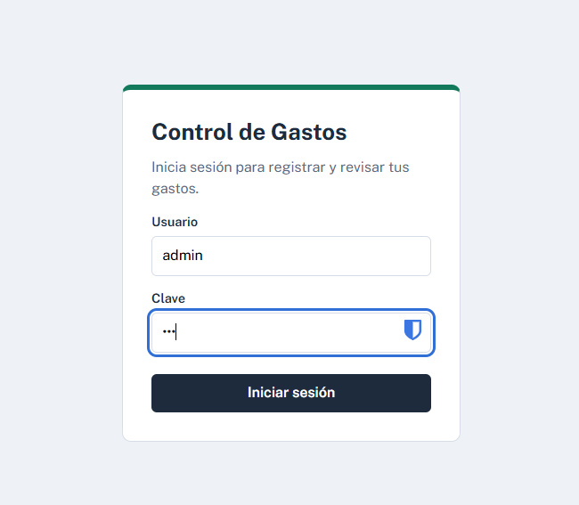
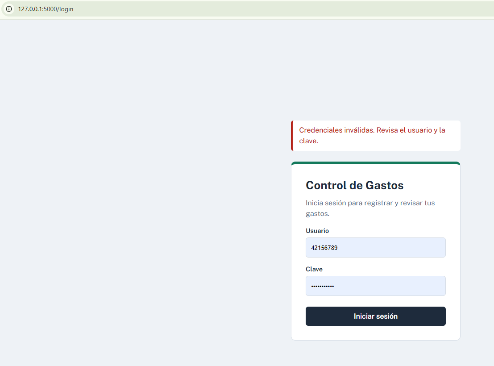
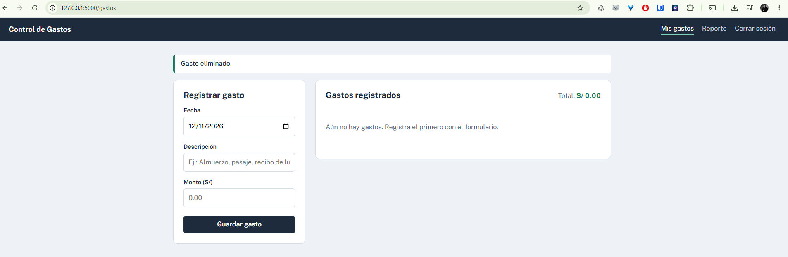
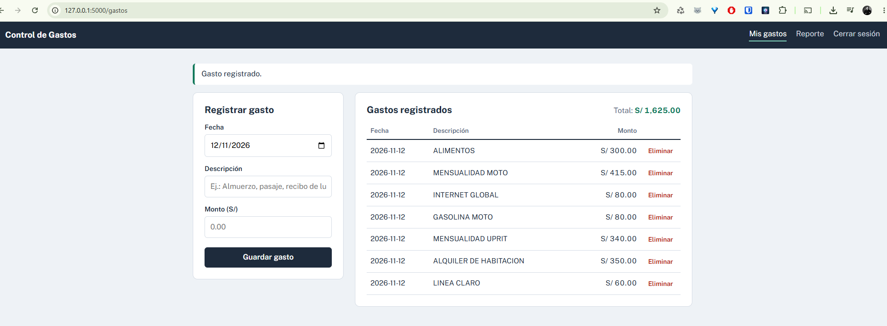
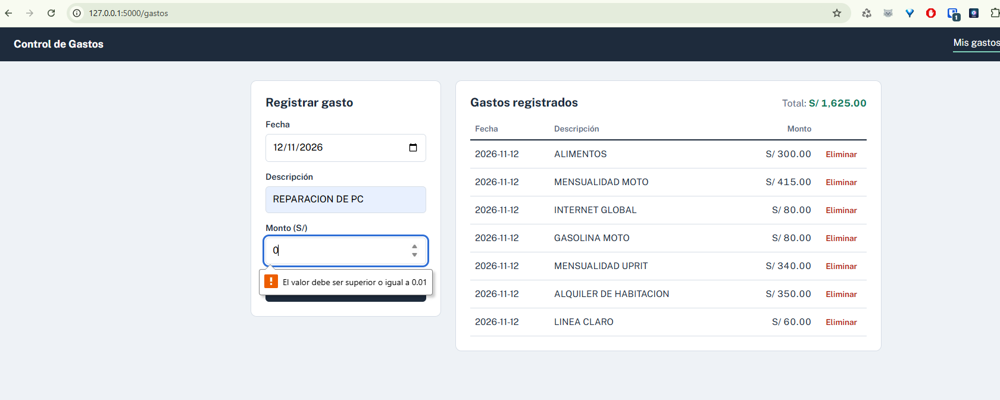
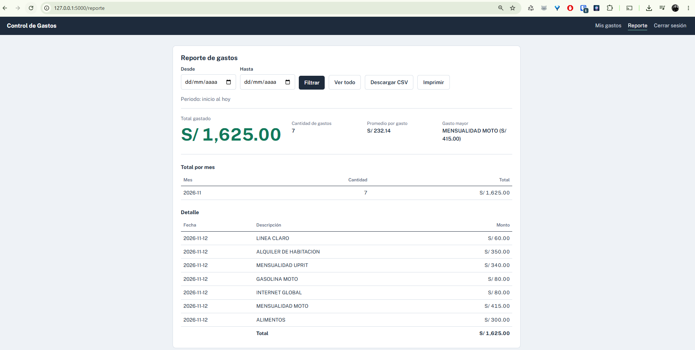
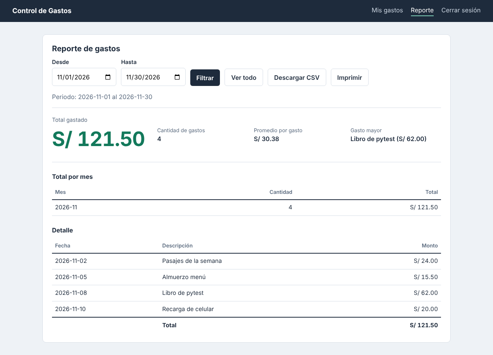

# Control de Gastos

Aplicación web para registrar gastos personales (fecha, descripción y monto) y generar un reporte con totales. Desarrollada con **Python**, **Flask** y **SQLite** como Práctica Calificada 2 del curso Programación y Desarrollo Web.

| Dato | Detalle |
|---|---|
| Universidad | Universidad Privada de Trujillo (UPRIT) |
| Carrera | Ingeniería de Sistemas e Inteligencia Artificial, ciclo V |
| Curso | Programación y Desarrollo Web |
| Docente | Calero Huaman, Charlen Maximo |
| Estudiante | Frank Edelin Piña Irarica |

## Funcionalidades

- Acceso con usuario y clave (`admin` / `123`); las páginas internas están protegidas y redirigen al login si no hay sesión.
- Registro de gastos con validación en el servidor: fecha válida, descripción obligatoria (máx. 100 caracteres) y monto mayor que cero.
- Listado de gastos con total acumulado y opción para eliminar.
- Reporte con total gastado, cantidad, promedio, gasto mayor, total por mes y detalle.
- Filtro del reporte por rango de fechas, descarga en CSV (se abre en Excel) e impresión.
- Registro de eventos con `logging` y página 404 personalizada.
- 43 pruebas automatizadas con pytest (unitarias y de rutas).

## Tecnologías

Python 3.10+, Flask 3, SQLite 3, Jinja2, HTML y CSS, pytest y pytest-cov.

## Estructura del proyecto

```
control_gastos/
├── app.py                 # Aplicación Flask: rutas, sesión y base de datos
├── utils.py               # Validación de gastos y formato de montos
├── requirements.txt
├── pytest.ini
├── .gitignore
├── templates/             # base, login, gastos, reporte y 404
├── static/style.css
├── docs/capturas/         # Capturas usadas en este README
└── tests/
    ├── conftest.py        # Fixtures: app con base temporal, cliente, cliente logueado
    ├── test_utils.py      # Pruebas unitarias
    └── test_rutas.py      # Pruebas de rutas con el cliente de Flask
```

## Instalación

```bash
git clone https://github.com/USUARIO/control-gastos-flask.git
cd control-gastos-flask
python -m venv venv
venv\Scripts\activate          # Windows
# source venv/bin/activate     # Linux / macOS
pip install -r requirements.txt
```

## Ejecución

```bash
flask --app app run --debug
```

Abrir `http://127.0.0.1:5000` e ingresar con usuario **admin** y clave **123**. La base de datos `gastos.db` se crea sola la primera vez.

## Funcionamiento

### 1. Inicio de sesión
El usuario ingresa sus credenciales. Si son correctas entra a la pantalla de gastos.



Si el usuario o la clave son incorrectos se muestra el mensaje «Credenciales inválidas».



### 2. Registro de gastos
A la izquierda está el formulario (fecha, descripción y monto); a la derecha, la lista de gastos con el total acumulado.





Los datos se validan también en el servidor; por ejemplo, un monto negativo no se guarda.



### 3. Reporte
Muestra el total gastado, la cantidad de gastos, el promedio, el gasto mayor, el total por mes y el detalle. Se puede descargar en CSV o imprimir.



Con los campos *Desde* y *Hasta* se filtra un periodo, por ejemplo solo noviembre.



## Rutas principales

| Método | Ruta | Descripción |
|---|---|---|
| GET/POST | `/login` | Formulario de acceso |
| GET | `/logout` | Cierra la sesión |
| GET/POST | `/gastos` | Lista y registra gastos (requiere sesión) |
| POST | `/gastos/<id>/eliminar` | Elimina un gasto (requiere sesión) |
| GET | `/reporte?desde=&hasta=` | Reporte con filtro opcional (requiere sesión) |
| GET | `/reporte/csv` | Descarga el reporte en CSV (requiere sesión) |

## Casos de prueba

| ID | Caso | Datos de entrada | Resultado esperado | Prueba automatizada |
|---|---|---|---|---|
| CP-01 | Login correcto | admin / 123 | Redirige a `/gastos` | `test_login_correcto` |
| CP-02 | Clave incorrecta | admin / 999 | Mensaje «Credenciales inválidas» | `test_login_clave_incorrecta` |
| CP-03 | Acceso sin sesión | Abrir `/gastos` | Redirige a `/login` | `test_gastos_sin_sesion` |
| CP-04 | Registrar gasto válido | 2026-11-10, Almuerzo menu, 15.50 | Mensaje «Gasto registrado» y aparece en la lista | `test_registrar_gasto` |
| CP-05 | Monto inválido | monto = "abc" | Mensaje de error, no se guarda | `test_registrar_monto_invalido_no_guarda` |
| CP-06 | Eliminar gasto | Gasto existente | Mensaje «Gasto eliminado» y ya no aparece | `test_eliminar_gasto` |
| CP-07 | Total del reporte | 80 + 20.50 | Total S/ 100.50 y agrupado por mes | `test_reporte_total` |
| CP-08 | Filtro por fechas | 01/11/2026 al 30/11/2026 | Solo aparecen gastos de noviembre | `test_reporte_filtrado_por_fechas` |

Además, `test_utils.py` aplica **valores límite** (descripción de 99, 100 y 101 caracteres; monto 0.01 frente a 0) y **clases de equivalencia** (montos negativos, texto, vacío, `nan`, `inf`; fechas con formato o día inválido).

## Pruebas

Las pruebas usan una base de datos temporal, nunca la base real, y cada prueba es independiente.

```bash
pytest -v                 # ejecutar todas las pruebas
pytest -k reporte         # solo las del reporte
pytest --cov=app --cov=utils   # con cobertura
```


## Autor

Frank Edelin Piña Irarica, Ingeniería de Sistemas e Inteligencia Artificial, UPRIT.
